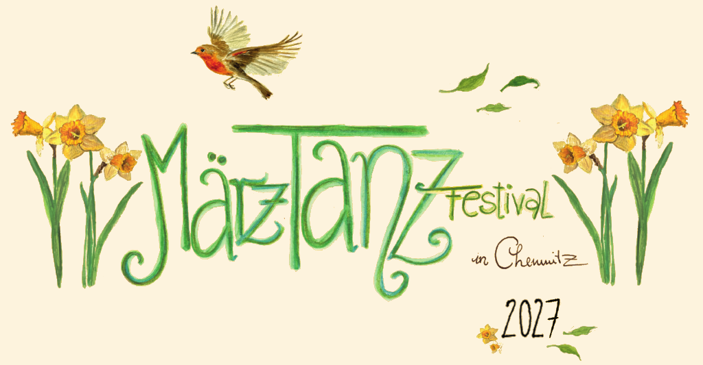
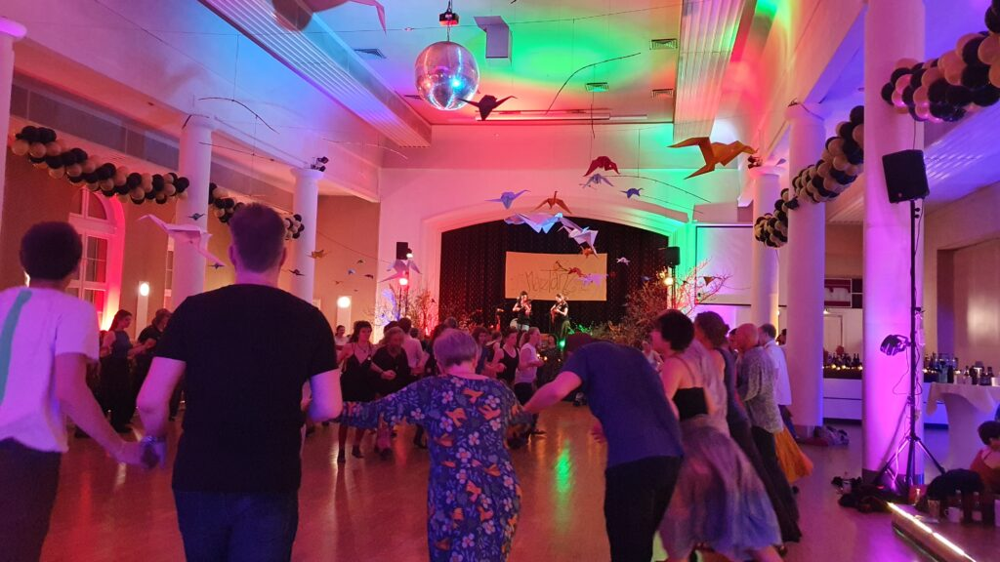
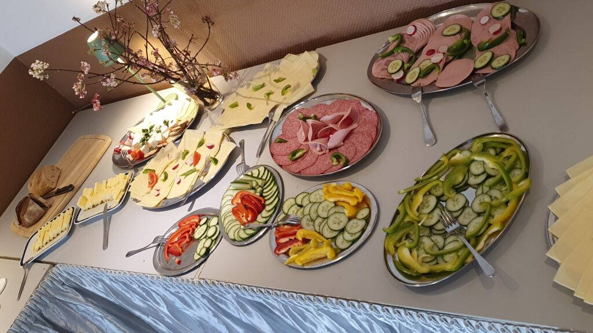

## 4. MärzTanz Festival
## 04.-07. März 2027

Balfolk vom Feinsten mit Bands aus Deutschland und Europa. Tagsüber wird es Workshops geben, abends spielen Bands zum Tanz.

<a class="btn btn-lg" href="https://eveeno.com/maerztanz2027">Jetzt hier anmelden!</a>

### Bands

#### [Feather and Fox](https://featherandfox.com/)

[split]
[col]

[/col]
[col]
Feather and Fox ist ein belgisch-deutsches Cello und Mandolinenduo. Christiane und Victor lernten sich in einem Berliner Sommer am Spreeufer kennen und reisen seitdem mit ihrer einfühlsamen Musik durch die Balfolkszene Europas. Von Beginn an spielt das Duo für Tänzer:innen und lässt sich von deren Energie inspirieren. Verspielt und feinfühlig erkunden sie die Klangmöglichkeiten im Zusammenspiel der zwölf Saiten ihrer Instrumente und kreieren damit einen einzigartigen Klang, zugleich federleicht und energiegetrieben.

*Christiane Bisitz – Cello, Gesang*  
*Victor Lekeu – Mandoline, Percussion*
[/col]
[/split]

#### [Folk My Life!](https://folkmylife.de/) – Modern-Trad Folkmusik

[split]
[col]
Folk my Life! ist ihre Begeisterung für Musik mit jedem Klang anzumerken. Die Band präsentiert selbstkomponierte Musik, die vom schwedischen Folk beeinflusst ist. Gleichzeitig beschäftigte sie sich mit deutschem Folk und stieß dabei auf die bedeutende [Dahlhoff-Sammlung](https://folkmylife.de/), die im Jahr 2012 digitalisiert und damit einer breiten Öffentlichkeit zugänglich gemacht wurde. Die vier jungen Musiker*innen greifen die überlieferten Tanzstücke aus der Dahlhoff-Sammlung aus dem 18. Jahrhundert musikalisch auf und schaffen eigene Kompositionen, die verspielt und manchmal sogar rockig klingen.

*Alexa Gödde – Saxophon, Geige*  
*Johannes Rüttermann – Nyckelharpa*  
*Blanche Oguey – Nyckelharpa*  
*Alexander Peters – Gitarre*
[/col]
[col]

[/col]
[/split]

#### [Wings & Tales](https://www.wingsandtales.de/)

[split]
[col]

[/col]
[col]
Natur, Mehrklang, Tanzparty und Liebe. Unser Balfolk ist eine Reise zu lebenfrohen Melodien, stampfenden Rhythmen, einfühlsamen Texten und dem Zauber der Natur.

*Fili – Geige, Vocals, Obertongesang*  
*Martin – Rhythmusgitarre, Vocals, Rahmentrommel*  
*Niklas – Kontrabass, Vocals*  
*Helena – Flöte, Vocals*
[/col]
[/split]

#### [Drehwurm](https://drehwurm.band/)

[split]
[col]
Wir sind Drehwurm aus Berlin, Lübeck und Erfurt. Uns verbindet nicht nur unsere Nähe zu Dresden, sondern besonders unsere Freude am gemeinsamen Musizieren.

Unsere Stücke sind selbstgeschrieben und vielschichtig, wie unsere Liebe zu Zwiebeln. Sie sind geprägt von internationaler Folkmusik (ägyptischen Trolltänzen, Metal,…) sowie von Liedermachern und Holter-die-polter-Polka. Diese Stilrichtungen finden sich in schwindelerregenden Walzern, träumerischen Gavottes, angriffslustigen Bourrees und flott geflöteten Polkas wieder. Dazu gibt es eigene Texte, inhaltlich gestreut von philosophischen Themen über Landschaftsbeschreibungen bis hin zu Gutenachtliedern. Mit einer Prise Albernheit gestalten wir unsere Musik sowohl tanzbar als auch zum lauschen.

*Hannah – Cello, Stimme*  
*Max – Oboe*  
*Nico – Gitarre, Bouzouki*  
*Teresa – Gitarre, Stimme, Flöten*
[/col]
[col]

[/col]
[/split]

#### [Accords Perdus](https://accordsperdus.com/)

[split]
[col]

[/col]
[col]
Accords Perdus ist seit jeher in der Folk-Szene aktiv, sowohl im Bereich des Tanzes als auch der Musik, und bietet ein Repertoire aus eigens für den Ball komponierten Stücken, gemischt mit einigen Perlen, die aus den unterschiedlichsten traditionellen Repertoires zusammengetragen wurden.

Klavier, Gesang, Klarinette, Bassklarinette, Slam und Duduk verschmelzen fröhlich miteinander und bieten Ihnen einen Ball voller Witz, Energie und Emotionen.

Juckt es Ihnen in den Beinen? Dann stürzen Sie sich in den Tanz…

*Pauline Gonzalez – Klavier, Gesang, Akkordeon*  
*Emile Postic – Klarinette, Bassklarinette, Duduk*
[/col]
[/split]

#### [Duo Suchanek & Peters](https://ursulasuchanek.com/projekte/duo-suchanek-peters-7)

[split]
[col]
Musik der Tanzböden des 18. und 19. Jahrhunderts für das Hier und Jetzt.

Eine große Liebe zu traditioneller Tanzmusik aus Musikerhandschriften der letzten 300 Jahre ist es, die die beiden Musiker*innen Ursula Suchanek und Alexander Peters verbindet. Ob hymnisch barocke Polonaisen, süße einzeilige Schleifer, witzige Walzer oder Polkas mit Techno-Rave-Feeling. Einige klingen einzigartig, andere haben enge Verwandtschaften mit Melodien anderer europäischer Musiktraditionen.

Die Neu-Interpretation des Duos kombiniert dabei eine durchaus traditionelle Tanzmusik-Perspektive mit gewagter Improvisation und harmonischen Klangwelten des 21. Jahrhunderts.

*Ursula Suchanek – Quinton*  
*Alexander Peters – Gitarre, Mandoline, Waldzither*
[/col]
[col]

[/col]
[/split]

#### [Richard](http://www.sturmfalken.de/richard/)

[split]
[col]

[/col]
[col]
Richard ist ein junger Musiker aus Chemnitz und spielt chromatisches sowie diatonisches Akkordeon. In der Folk-Szene groß geworden, entwickelt er ständig neue Leidenschaften für unterschiedliche Musikrichtungen. Inspirationen liefern von Naragonia bis Astor Piazolla verschiedenste Musiker und Bands aus Europa und der Welt.
[/col]
[/split]

### Workshops

Du möchtest einen Workshop geben? Dann schreib eine Mail an maerztanz at dckn.de

### Ort und Anreise

[split]
[col]
Dieses Jahr tanzen wir wieder im wunderschönen Tanzsaal im [**Haus des Gastes**](https://www.hausdesgastes.info/raumlichkeiten/veranstaltungsraume/) Chemnitz-Reichenbrand. Dort haben wir auch sehr schöne Workshopräume zur Verfügung.

[Haus des Gastes Reichenbrand
Zwickauer Straße 485
09117 Chemnitz](https://osm.org/go/0MISr3bl--?m=)

- nächster Bahnhof: Chemnitz Siegmar (16 min zu Fuß, Regionalbahn Strecke Zwickau-Dresden)
- nächste Bushaltestelle: Kirche Reichenbrand (direkt gegenüber)
- Parken ist in den umliegenden Straßen kostenlos möglich. **Parkverbot im Hof!** (Der Hof für Mitarbeiter und Künstler reserviert.)

[gis marker1="Haus des Gastes Reichenbrand, 50.8115423, 12.8285122, green" marker2="Bahnhof Chemnitz-Siegmar, 50.8155542, 12.8430079, red" marker3="Bushaltestelle Kirche Reichenbrand, 50.8122284, 12.8295201, orange"]
[/col]
[col]

[/col]
[/split]

### Unterkunft

Wir können in der angrenzenden Turnhalle einige Schlafplätze im Matratzenlager (mit eigener Isomatte+Schlafsack) anbieten. Die Pensionszimmer stehen nicht zur Verfügung, da sie langfristig vermietet sind.
In der Nähe gibt es 1 Pension, in der ich Zimmer reserviert habe. (15-20 min zu Fuß)
Außerdem haben wir ein paar Schlafplätze frei, diese sind aber nachts nur mit dem Auto (17min) erreichbar.
Bitte sonst auch selbständig um Übernachtungen kümmern.
Wer Platz bei sich anbieten kann, gibt das in der Anmeldung bitte mit an, dann können wir vielleicht eine Schlafplatzbörse einrichten.

### Verpflegung

[split]
[col]

[/col]
[col]
Donnerstag Abend gestalten wir ein gemeinsames Mitbringbuffet ab 17:30 Uhr. Bitte beschriftet eure Buffetbeiträge (vegan, vegetarisch, mit Fleisch, Gluten)

Im Festivalpreis inklusive:

- 1 warme Mahlzeit Fr 16:30 – 18:00 Uhr
- Mitternachtssnack Fr
- 1 warme Mahlzeit Sa 16:30 – 18:00 Uhr
- Mitternachtssnack Sa
- Sonntag Brunch 9:00-13:00 Uhr

Extra:
Frühstück Fr und Sa 9 – 12 Uhr ist bei Bedarf dazubuchbar
[/col]
[/split]

### Kleidertausch / Verschenketisch

Ihr könnt ein paar Kleidungsstücke mitbringen, die nicht mehr getragen werden, aber in gutem Zustand für neue Besitzer sind und sucht euch etwas aus von den vorhandenen Dingen. Kleidungsstücke für Menschen jeden Alters, Schuhe, CDs, Bücher. Es ist auch möglich, nur zu finden.
Was übrig bleibt, geht an Unterstützungsprojekte für Menschen, denen es weniger gut geht im Leben.

Wer nur am Kleidertausch oder einem Workshop teilnehmen möchte, braucht dafür kein Ticket, ist aber herzlich eingeladen, dem Verein eine Spende dazulassen.

### Co-Kreation

…wie ihr sie vom SimmelFolk Festival schon kennt.

Dieses Festival ist ein **Gemeinschaftsprojekt**.
Es lebt mit euch, durch euch, von euch.
Ohne euch gibt es kein Festival.

Jede:r ist eingeladen sich mit ihren/seinen Fähigkeiten, Energie und Präsenz einzubringen, um das Festival mitzugestalten, egal ob als Musiker:in oder Workshopleiter:in, beim Kochen, vorbereiten oder aufräumen.
Jede:r Teilnehmende trägt ein oder zwei kleine "Ämtli", so erschaffen wir ein Balfolk-Festival – das ist Co-Kreation!
Nach der Ankunft könnt ihr euch für euer Ämtli im Plan eintragen.

Meldet euch gern, wenn ihr euch in der Organisation im Vorfeld oder direkt beim Festival mit eigenen Ideen und tatkräftigen Händen einbringen wollt.

### Festivalkarten

In dem Teilnahmebeitrag ist alles inklusive: 3,5 Tage Festival, alle Bälle, Verpflegung, Workshops.

Jede:r wird ein Ämtli übernehmen um zum Gelingen des Festivals beizutragen.

Wenn es dir möglich ist, etwas mehr zu geben, darfst du gern zum Ticket eine Spende ergänzen und dazu beitragen, dass das Festival ein voller Erfolg wird.

- **Standardpreis** für ein Wochenendticket: **150 €**
- **Ermäßigte** Tickets: **130 €** (für Geringsverdiener, Menschen in Engpässen oder besonderen Belastungen, aus Ländern mit niedrigerem Lohnniveau oder wenn du dir das volle Ticket einfach nicht leisten kannst)
- **Schüler/Studenten/Auszubildende**: **100 €** für das Wochenende
- **Kinder** bis 15: frei

**Abendkarten** sind ab März erhältlich, wenn das Festival nicht ausverkauft ist, und berechtigen zur Teilnahme an den Bällen des Abends (ab 19:30/19:00/18:30). Die Abendsuppe ist im Preis enthalten, die warme Mahlzeit am Nachmittag nicht.

<a class="btn btn-lg" href="https://eveeno.com/maerztanz2027">Jetzt hier anmelden!</a>

#### Storno

Wenn das Festival aus Gründen höherer Gewalt abgesagt werden müsste, werden die Kosten erstattet.
Im Falle, dass ihr doch nicht teilnehmen könnt, ist eine Erstattung ausgeschlossen. Ihr könnt das Ticket einer anderen Person weitergeben.

### Code of Conduct

Willkommen sind hier Menschen jeglichen Alters – sehr gern in der ganzen Familie, jeglicher Hautfarbe, Herkunft, Glaubensrichtung, Geschlechtsidentität oder sexueller Orientierung.
Du darfst hier so sein, wie du bist. Gewalt und berauschende Drogen haben hier allerdings keinen Platz.
Wir wünschen uns ein friedvolles, unterstützendes Miteinander, wo jede:r auf den anderen Menschen achtet und sie/ihn in seiner/ihrer Einzigartigkeit respektiert.

Beim Tanzen geht es um die Gemeinschaft, nicht um Perfektion. "Dance roles are social constructs." = Tanze in der Rolle, die du möchtest. Du darfst jeden Menschen (egal welchen Alters, Geschlechts, …) zum Tanz bitten und jeder darf die Bitte frei beantworten. Solltest du ein Nein erhalten, betrachte es mit Dankbarkeit. Du hast in dem Moment ein Ja des anderen Menschen zu den eigenen Bedürfnissen erhalten.
Im Tanzsaal ist während des Balls Zeit der Musik zu lauschen und dazu zu tanzen. Für Gespräche gibt es in anderen Räumen und in den Pausen Gelegenheit.
Bitte achtet bei euren Tänzen auch auf eure Umgebung. Manchmal ist nicht genug Platz für sehr ausladende Figuren, dann spart sie euch bitte für Momente mit mehr Platz auf. Wenn ihr euch in eine Kette einreihen wollt, dann bitte am Ende anhängen. In Kreisen im besten Fall schon mit dem aufgenommenen Rhythmus und zu einem günstigen Zeitpunkt einsteigen, um die anderen nicht aus dem Takt zu bringen. Nicht alle tanzen schon seit Jahren und sind in den Tänzen sicher.
Bei Paartänzen, die sich im Raum bewegen, sind die Tänzer, die am Platz tanzen in der Mitte und die Tänzer, die in Tanzrichtung durch den Raum tanzen, außen.
Bist du neu im Balfolk, wird es die Möglichkeit geben, mit einem Erkennungszeichen darauf aufmerksam zu machen, dass du den Wunsch hast, von erfahrenen Tänzer:innen an die Hand genommen zu werden.

Im Ruheraum darf geruht, geschlafen, massiert, gekuschelt werden. Ist niemand zum Schlafen da, dürft ihr dort auch tuscheln.

Bitte geh achtsam mit den Räumen und allen Gegenständen um. Fällt dir etwas auf, was nicht in Ordnung ist oder sollte dir versehentlich etwas kaputt gegangen sein, wäre es schön, wenn du dafür Sorge trägst, dass es in Ordnung kommt oder eine Info an das Orgateam weiterreichst.
Beim Tanz-Wochenende werden Fotos und Videos erstellt und den Teilnehmern zugänglich gemacht. Manche der Daten werden auch öffentlich verwendet. Mit deiner Teilnahme erklärst du dich damit einverstanden. Falls du nicht einverstanden bist, muss die Einwilligung schriftlich bei DCKN e.V. widerrufen werden.

Auf ein schönes gemeinsames Tanzfest!
