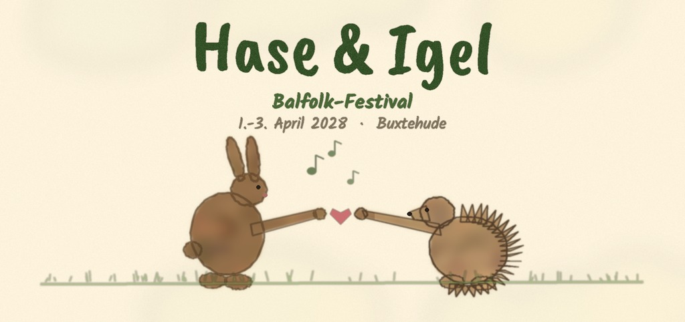

*Bild: Lena (2a)*

# Hase & Igel Festival
## Balfolk-Festival · 01.-03. April 2028 · Buxtehude

Drei Tage Balfolk mit Live-Musik und Tanz in Buxtehude.

### Bands

#### Bargainatt (F)

[split]
[col]

[/col]
[col]
Bargainatt entstand Anfang 2016 in Montpellier aus der Freundschaft von vier Musiker:innen. Der Name ist eine Wortschöpfung aus „bargain“ (Markt) und „hat“ (Hut) — die ersten Proben fanden auf Märkten statt. Seitdem tourt die Band mit eigenen Kompositionen, inspiriert von traditionellen Melodien und den Tänzen aus ganz Frankreich, durch Europa: über 250 Bälle und vier Studioalben.

*Noé Bazoge – Cello* 
*Youmi Bazoge – Violine, Gesang* 
*Camille Stimbre – Violine* 
*Léon Ollivier – diatonisches Akkordeon*

[Website](https://www.bargainatt.com)
[/col]
[/split]

#### L'Air Inconnu (F)

[split]
[col]
Das französische Trio verbindet eigene Kompositionen mit Arrangements traditioneller Themen — geprägt von der Energie der Bälle: Begegnung, Poesie, klangliche Wucht und kollektive Trance. Aktuelles Album: „Jamais entendu parler“.

*Fabien Bucher – Gitarre, Mandoline, Gesang* 
*Dani Velasco – Violine, Gesang* 
*Sylvain Pool – Akkordeon, Gitarre, Kick, Gesang*

[Website](https://www.canibalproductions.net/lairinconnu)
[/col]
[col]

[/col]
[/split]

#### Ciac Boum (F)

Das Trio aus dem Poitou mischt die traditionelle Musik seiner Region mit improvisatorischer Freiheit in Melodik und Rhythmik. Mit „L'homme sans tête“ (2020) und „Épourall“ (2024) hat sich die Band weit über Frankreich hinaus einen Namen in der Balfolk-Szene gemacht.

*Christian Pacher – Violine, Gesang* 
*Alban Pacher – Violine, Gesang* 
*Julien Padovani – chromatisches Akkordeon, Basstrommel, Gesang*

#### Sous le Pont (F)

[split]
[col]

[/col]
[col]
Das Trio aus der Gegend von Avignon (2009–2019, seither gelegentliche Wiederauftritte) ist für seine ungewöhnliche Besetzung bekannt: Posaune, Xylophon und Akkordeon. Zwischen Tradition, Jazz und aktueller Musik entsteht ein eigenständiges Repertoire für den Tanz — u.a. auf dem Album „EtLàC'EstQuoi“ (2015).

*Raphaël André – Posaune, Gitarre, Tanzleitung* 
*Guillaume Viala – Xylophon, Percussion* 
*Jean-Baptiste Brunel – Akkordeon*

[Website](https://souslepont.org/sousLePont/)

*Foto: Anahi Matteo*
[/col]
[/split]

#### Drehwurm (D)

[split]
[col]
Drehwurm aus Berlin, Lübeck und Erfurt verbindet die Freude am gemeinsamen Musizieren. Die selbstgeschriebenen Stücke sind geprägt von internationaler Folkmusik: schwindelerregende Walzer, träumerische Gavottes, angriffslustige Bourrées und flott geflötete Polkas, dazu eigene Texte von philosophisch bis Gutenachtlied. Mit einer Prise Albernheit wird die Musik tanzbar und zum Lauschen zugleich.

*Hannah – Cello, Stimme* 
*Max – Oboe* 
*Nico – Gitarre, Bouzouki* 
*Teresa – Gitarre, Stimme, Flöten*
[/col]
[col]

[/col]
[/split]

#### Richard (Chemnitz)

[split]
[col]

[/col]
[col]
Richard ist ein junger Musiker aus Chemnitz und spielt chromatisches sowie diatonisches Akkordeon. In der Folk-Szene groß geworden, entwickelt er ständig neue Leidenschaften für unterschiedliche Musikrichtungen. Inspirationen liefern von Naragonia bis Astor Piazzolla verschiedenste Musiker und Bands aus Europa und der Welt.
[/col]
[/split]

## Anfahrt

### Mit Bahn und Bus

Buxtehude ist gut mit öffentlichen Verkehrsmitteln erreichbar: Der Bahnhof Buxtehude wird von der S-Bahn Hamburg (S3) sowie von Regionalzügen angefahren. *[Vom Bahnhof zum Festivalort: Entfernung, Buslinie oder Shuttle ergänzen]*

Die Fahrplanauskunft des Hamburger Verkehrsverbunds findet ihr unter [hvv.de](https://www.hvv.de/).

### Mit dem Auto

Buxtehude liegt südlich von Hamburg und ist über die A1 und die A26 erreichbar.

**Parken:** *[Parkplatz bzw. Adresse und Parkhinweise ergänzen]*

## Unterkunft

### Schlafsaal

[split]
[col]

[/col]
[col]
Wir richten ein Matratzenlager ein. Bringt alles mit, um es euch gemütlich zu machen – Isomatte, Schlafsack, Decken etc.

*[Ort des Schlafsaals, An- und Abreisezeiten ergänzen]*
[/col]
[/split]

### Camping

**Zelten**

[split]
[col]

[/col]
[col]
Wenn ihr zelten möchtet, sagt bitte in der Anmeldung Bescheid. Sanitäre Anlagen sind vorhanden. Bitte keine Autos auf den Rasen und kein offenes Feuer.

*[Zeltplatz ergänzen]*
[/col]
[/split]

**Wohnmobile**

*[Stellplatz für Vans und Wohnmobile ergänzen]*

### Privatunterkunft

- [Gemeinde Buxtehude](https://www.buxtehude.de/)
- [AirBnB](https://www.airbnb.de/s/Buxtehude--Deutschland/homes)
- [FeWo-direkt](https://www.fewo-direkt.de/search/keywords:buxtehude-niedersachsen-deutschland/)

## Verpflegung

[split]
[col]

[/col]
[col]
Am Donnerstag Abend gestalten wir ein gemeinsames Mitbringbuffet ab 17:30 Uhr. Bitte beschriftet eure Buffetbeiträge (vegan, vegetarisch, mit Fleisch, Gluten).

Im Teilnahmebeitrag inklusive:

- 1 warme Mahlzeit Fr 16:30 – 18:00 Uhr
- Mitternachtssnack Fr
- 1 warme Mahlzeit Sa 16:30 – 18:00 Uhr
- Mitternachtssnack Sa

Extra:
Frühstück Fr und Sa 9 – 12 Uhr ist bei Bedarf dazubuchbar.
[/col]
[/split]

## Code of Conduct

Willkommen sind hier Menschen jeglichen Alters – sehr gern in der ganzen Familie, jeglicher Hautfarbe, Herkunft, Glaubensrichtung, Geschlechtsidentität oder sexueller Orientierung.
Du darfst hier so sein, wie du bist. Gewalt und berauschende Drogen haben hier allerdings keinen Platz.
Wir wünschen uns ein friedvolles, unterstützendes Miteinander, wo jede:r auf den anderen Menschen achtet und sie/ihn in ihrer/seiner Einzigartigkeit respektiert.

Beim Tanzen geht es um die Gemeinschaft, nicht um Perfektion. "Dance roles are social constructs." = Tanze in der Rolle, die du möchtest. Du darfst jeden Menschen (egal welchen Alters, Geschlechts, …) zum Tanz bitten und jeder darf die Bitte frei beantworten. Solltest du ein Nein erhalten, betrachte es mit Dankbarkeit. Du hast in dem Moment ein Ja des anderen Menschen zu den eigenen Bedürfnissen erhalten.
Im Tanzsaal ist während des Balls Zeit der Musik zu lauschen und dazu zu tanzen. Für Gespräche gibt es in anderen Räumen und in den Pausen Gelegenheit.
Bitte achtet bei euren Tänzen auch auf eure Umgebung. Manchmal ist nicht genug Platz für sehr ausladende Figuren, dann spart sie euch bitte für Momente mit mehr Platz auf. Wenn ihr euch in eine Kette einreihen wollt, dann bitte am Ende anhängen. In Kreisen im besten Fall schon mit dem aufgenommenen Rhythmus und zu einem günstigen Zeitpunkt einsteigen, um die anderen nicht aus dem Takt zu bringen. Nicht alle tanzen schon seit Jahren und sind in den Tänzen sicher.
Bei Paartänzen, die sich im Raum bewegen, sind die Tänzer, die am Platz tanzen in der Mitte und die Tänzer, die in Tanzrichtung durch den Raum tanzen außen.

Im Ruheraum darf geruht, geschlafen, massiert, gekuschelt werden. Ist niemand zum Schlafen da, dürft ihr dort auch tuscheln.

Bitte geh achtsam mit den Räumen und allen Gegenständen um. Fällt dir etwas auf, was nicht in Ordnung ist oder sollte dir versehentlich etwas kaputt gegangen sein, wäre es schön, wenn du dafür Sorge trägst, dass es in Ordnung kommt oder eine Info an das Orgateam weiterreichst.
Beim Tanz-Wochenende werden Fotos und Videos erstellt und den Teilnehmern zugänglich gemacht. Manche der Daten werden auch öffentlich verwendet. Mit deiner Teilnahme erklärst du dich damit einverstanden. Falls du nicht einverstanden bist, muss die Einwilligung schriftlich bei DCKN e.V. widerrufen werden.

Auf ein schönes gemeinsames Tanzfest!
